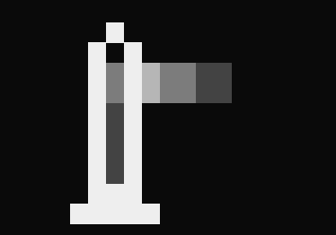
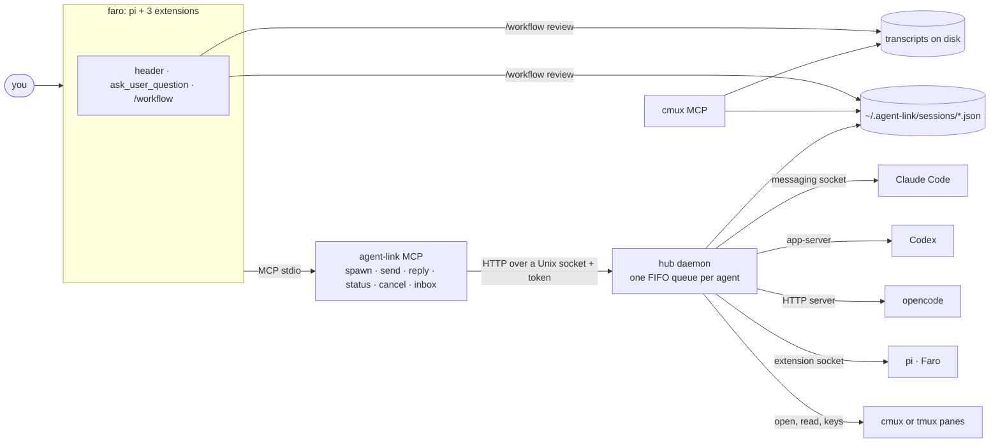

<p align="center">
  
</p>

# Faro

**Bring light to your agents.**

<p>
  <a href="https://github.com/Jero110/faro-agent/actions/workflows/ci.yml"></a>
  
  
</p>

Faro is a coding agent built on [pi](https://github.com/earendil-works/pi) that plans with you, then hands the plan to
other agents (Claude Code, Codex, opencode, more Faros) that build it in their own terminal panes while you watch.
Afterwards it tells you what each one did, with which skills, how many tokens and how much time.

Faro does not fork pi. It is pi, unmodified, with its own config folder and three extensions, plus two small tools any
harness can use:

- **agent-link** launches, messages and stops other agents, each in a pane with its own native UI, and keeps a journal
  of every session so the work survives a crash.
- **cmux MCP** finds and reads any agent's session, arranges cmux (tabs, panes, workspaces) and drives its browser.

## Install

```bash
curl -fsSL https://raw.githubusercontent.com/Jero110/faro-agent/main/install.sh | bash
```

The installer asks one question, **cmux or tmux**, and sets up the rest:

- `faro` and `agent-link` in `~/.local/bin`, the code in `~/.faro/src`.
- The agent-link MCP server registered with every harness it finds (Claude Code, Codex, opencode, pi, Faro).
- With cmux, also the cmux MCP server. With tmux, only agent-link.
- Faro's own pi config in `~/.faro/agent`, reusing your pi login. Default model: Claude Sonnet.

Skip the question with `bash -s -- --backend cmux` (or `tmux`). Requirements: Node.js 24+, git, and cmux
([cmux.com](https://cmux.com), recommended) or tmux. Install the harnesses you want Faro to use: `claude`, `codex`,
`opencode`.

## Use

```bash
cd your-project
faro
```

Then ask for what you want, or start the workflow explicitly:

```
/skill:planner a small CLI that tracks my reading list
```

| Command | What it does |
| --- | --- |
| `/skill:planner <idea>` | Plans with you, then hands the plan to an executor agent. |
| `/workflow review` | What the last run did: tasks, agents, skills, tokens and time by role, harness and message, then recommendations. |
| `/workflow ask <question>` | Answers about your workflow, skills and setup; researches tools you name. |
| `/skill:<name>` | Runs any skill by hand, e.g. `/skill:code-review-and-quality`. |

Every pi option and command works too (`faro --model ...`, `/model`, `/login`).

## The workflow

```
you ─► planner (Faro, your pane)            executor (Faro, its own pane)         workers (their own panes)
       1. idea or from zero?                 reads the validated plan               claude · codex · opencode · faro
       2. investigate / brainstorm           dispatches each task ────────────────► build, test, report back
       3. pick development skills            verifies and integrates   ◄────────────
       4. grill-me (optional)                final report ─► planner
       5. write docs/plans/<slug>.md
       6. you approve ─► hand off ──────────►
```

The **planner** asks every question in a picker (`ask_user_question`), not in chat. It offers only the development
skills that fit the work, recommends a few, and puts only the ones you pick into the plan. The plan names, for each
task, the agent, harness and model, its skills, what can run in parallel and what waits.

The **executor** never asks you anything: it decides, records its assumptions, runs every task on the agent the plan
names, verifies, integrates, and reports. No skill fixes a model; the plan does, from what you asked for.

## Skills

Four groups. Pre-build and build run inside the workflow; post-build and extras are yours to invoke.

| Group | Skills |
| --- | --- |
| **Pre-build** | `planner` (Faro), `grilling` (Matt Pocock): the grill-me step |
| **Build** | `executor` (Faro); development skills (Addy): `test-driven-development`, `spec-driven-development`, `source-driven-development`, `security-and-hardening`, `performance-optimization`, `doubt-driven-development`, `constraint-driven-development`, `documentation-and-adrs`, `observability-and-instrumentation`, `incremental-implementation`, `git-workflow-and-versioning`, `ci-cd-and-automation` |
| **Post-build** | `shipping-and-launch` (Addy), `handoff` (Matt Pocock) |
| **Extras** | `api-and-interface-design`, `browser-testing-with-devtools`, `code-review-and-quality`, `debugging-and-error-recovery`, `code-simplification` (Addy); `impeccable` (Paul Bakaus, installed with `npx impeccable install`) |

The full catalog, with what each one does and its source: [skills/README.md](skills/README.md). Third-party skills keep
their licenses ([skills/LICENSES](skills/LICENSES/README.md)).

## When an agent stops halfway

Every agent agent-link launches is journaled in `~/.agent-link/sessions/`: who launched it, its task, its pane, its
session id and transcript path. Nothing depends on the hub or the agent still running.

- From any agent in cmux, ask in plain words ("what did the claude in the right pane get done?"): the cmux MCP's
  `list_agent_sessions` and `read_agent_transcript` find the session and read its transcript, never the screen.
- From a shell, anywhere: `agent-link sessions`, then `agent-link transcript <name>`.

So a Codex session can pick up where a stopped Claude Code session left off.

## Tools reference

**agent-link MCP** (every harness): `spawn`, `send`, `reply`, `status`, `cancel`, `inbox`.
CLI: `agent-link status | stop | sessions | transcript <agent> | open <harness> | install | uninstall`.

**cmux MCP** (cmux only):

| Area | Tools |
| --- | --- |
| Agent sessions | `list_agent_sessions`, `read_agent_transcript` |
| Tabs and panes | `list_surfaces`, `new_surface`, `close_surface`, `focus_surface`, `rename_tab`, `move_surface`, `reorder_surface`, `surface_health`, `new_pane`, `resize_pane`, `swap_pane` |
| Workspaces | `list_workspaces`, `current_workspace`, `select_workspace`, `new_workspace`, `rename_workspace`, `close_workspace` (shows the contents first, asks before closing running agents), `tree`, `identify` |
| Browser | `browser`: navigate, snapshot, click, type, wait, tabs, console, screenshots |

## Architecture



Every agent runs in its own pane with its native UI, and the hub reaches it by that harness's own interface, not by
typing into the screen. Nobody waits: `spawn` and `send` return at once, and a worker's final answer arrives in its
parent as a new message. The journal records every agent (parent, task, pane, session id, transcript path), so the
cmux MCP and `/workflow review` work after the hub or the agents are gone.

| Package | What it is |
| --- | --- |
| [`packages/faro`](packages/faro) | the `faro` command: launcher, setup, extensions (header, `ask_user_question`, `/workflow`) |
| [`packages/agent-link-core`](packages/agent-link-core) | hub daemon, one adapter per harness (claude, codex, opencode, pi), MCP server, guard, session journal |
| [`packages/agent-link`](packages/agent-link) | the composed hub and the `agent-link` CLI (`status`, `sessions`, `transcript`, `install`) |
| [`packages/agent-link-cmux`](packages/agent-link-cmux) | cmux pane backend and its MCP entry |
| [`packages/agent-link-tmux`](packages/agent-link-tmux) | tmux pane backend and its MCP entry |
| [`packages/agent-transcripts`](packages/agent-transcripts) | one reader for Claude, Codex, opencode, pi and Faro transcripts: messages, tokens, time, tools, skills |
| [`packages/cmux-mcp`](packages/cmux-mcp) | the cmux MCP server: agent sessions, tabs, panes, workspaces, browser |
| [`skills`](skills) | the four skill groups and their catalog |

How the pieces fit, in detail: [docs/architecture.md](docs/architecture.md).

## FAQ

**Why pi, and not a harness of its own?**
pi is small and its extension API gives Faro everything it needs (tools, commands, messages that start a turn, the
header) without a fork. Faro pins pi and keeps its own config in `~/.faro/agent`, so your plain pi stays as it is.

**Do I need cmux?**
You need cmux or tmux, because every agent gets its own pane. cmux adds the cmux MCP (sessions, layout, browser); with
tmux you get agent-link alone.

**What does it cost?**
What each harness spends with its provider. Faro calls no model on its own; `/workflow review` shows the tokens per
role, harness, agent and message. opencode defaults to a free model.

**What does Faro keep, and where?**
`~/.faro`: Faro's pi config, sessions and `/workflow` reports. `~/.agent-link`: the hub socket and token, the event log,
the session journal and the profiles. Nothing leaves your machine except what each harness sends to its own provider.

**Is it safe to leave several agents running?**
A guard checks shell commands: workers are blocked from `rm -rf`, `sudo`, `git push`, `git reset --hard` and similar,
and your own session is asked first. It is not a sandbox, and it only sees shell commands.

**Can workers launch their own workers?**
Yes: the executor is one. A worker talks only with its parent and its own workers.

## Develop

```bash
git clone https://github.com/Jero110/faro-agent && cd faro-agent
npm install --ignore-scripts
npm run check && npm test
bash install.sh            # installs from this checkout
```

Rules for contributors (and their agents) are in [AGENTS.md](AGENTS.md). Tests never call real models.

## Uninstall

```bash
faro uninstall             # removes the MCP registrations and the Faro profile
rm -rf ~/.faro ~/.local/bin/faro ~/.local/bin/agent-link
```

## License

MIT. Third-party skills under [skills/LICENSES](skills/LICENSES/README.md) keep their own licenses.
